# dsh-skill-browser 🧩 技能浏览器

> **功能描述**：技能与 MCP 浏览器：一个悬浮球五个页面。技能浏览（系统目录选库、两级分类加自定义分组、树状/平铺、手动/关键词/AI 分组且只发元数据、搜索、单卡或全库启停并自动备份）、调用台账（次数/成功率/趋势/排行）、MCP（真实 loader 配置与 Fiber 状态、工具与调用统计、启停即时跟随/重连/卸载/导出，并扫描未配置服务器做 AI 修复）、市场 · MCP 市场（官方 Registry + 29 条精选免费目录、19 大类平铺分类、网格/列表双模式、一键安装/卸载、仅免费筛选，与 MCP 页双向即时同步）、快速上手（9 步）；面板重绘不跳顶且关闭后记住上次滚动位置，卡片每行列数技能 3~6、MCP 3~5、市场 3~6。130 款皮肤在三颗悬浮球间同步。适配 DSH 内核 0.2.2-rc.1。
>
> **English**: Skills and MCP browser behind one floating ball with five tabs: Skills (native folder picker, two-level categories plus custom groups, tree or flat view, manual, keyword and AI grouping on metadata only, search, and per-card or whole-library enable/disable with timestamped backups), Call Ledger (counts, success rate, trend, ranking), MCP (live loader config, real Fiber states, per-server tools and call stats, instant enable/disable follow, reconnect, uninstall, export to mcpServers JSON, plus scan-and-AI-fix for unconfigured servers), Market (MCP market: official Registry plus a curated free catalog, 19 categories in flat mode, grid or list layout, one-click install/uninstall, free-only filter, two-way instant sync with the MCP tab) and Quick Start (9 steps). The panel never jumps back to the top on redraw and restores its scroll position when reopened. 130 skins sync across the three balls. Adapts DSH kernel 0.2.2-rc.1.


**把技能库变成看得见、搜得到、管得住的资产。**

DeepSeek Harness（DSH）桌面端 / 网页端插件：右下角一个「技」字悬浮球，点开即**技能与 MCP 浏览器**面板（五个 Tab：技能浏览 / 调用台账 / MCP / 市场 · MCP 市场 / 快速上手）——技能库秒级浏览、树状/平铺双视图、手动 + 关键词 + AI 三种分组（AI 分组带**结果缓存**与**计时浮窗**）、调用台账看板、**MCP 管理**（真实配置 / 状态 / 工具 / 调用统计 / 启停即时跟随 / 重连 / 卸载 / 导出，外加**本机 MCP 扫描**与**AI 修复**）、**市场 · MCP 市场**（官方 MCP Registry + 29 条精选免费目录、19 大类平铺分类带每类数量、网格/列表双模式、卡片逐字复刻技能卡、每条 MCP 用其自身真实图标、一键安装写入 `cordis.patch.yml` 并自动备份 / 一键卸载、仅免费筛选、24 小时磁盘缓存、与 MCP 页双向即时同步）、**滚动位置记忆**（关掉再打开回到原处，启停轮询也不跳顶）、130 款三球同步皮肤。**分组只是视图归档，绝不移动任何技能文件；AI 分组只读元数据，绝不读正文、绝不改技能。**

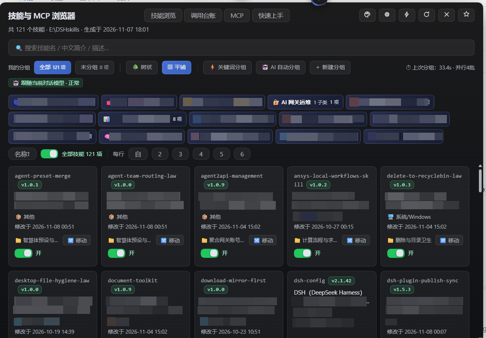
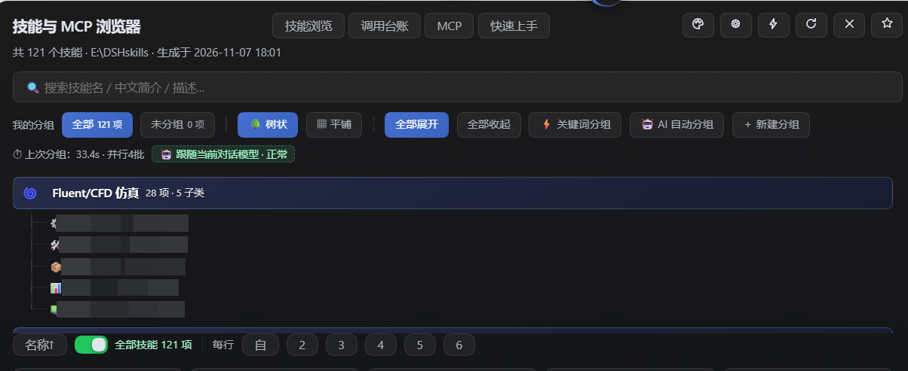
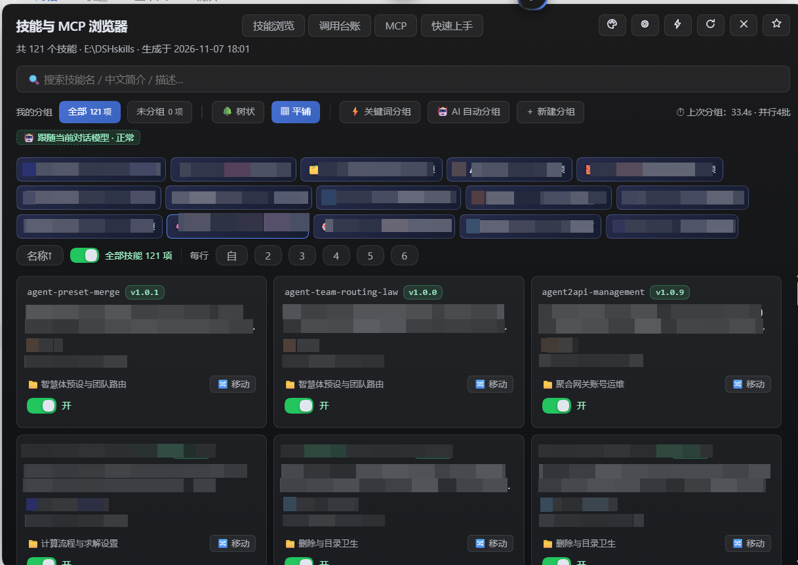
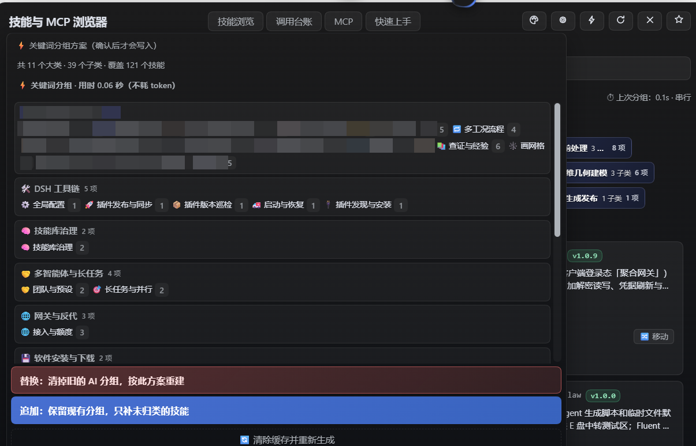
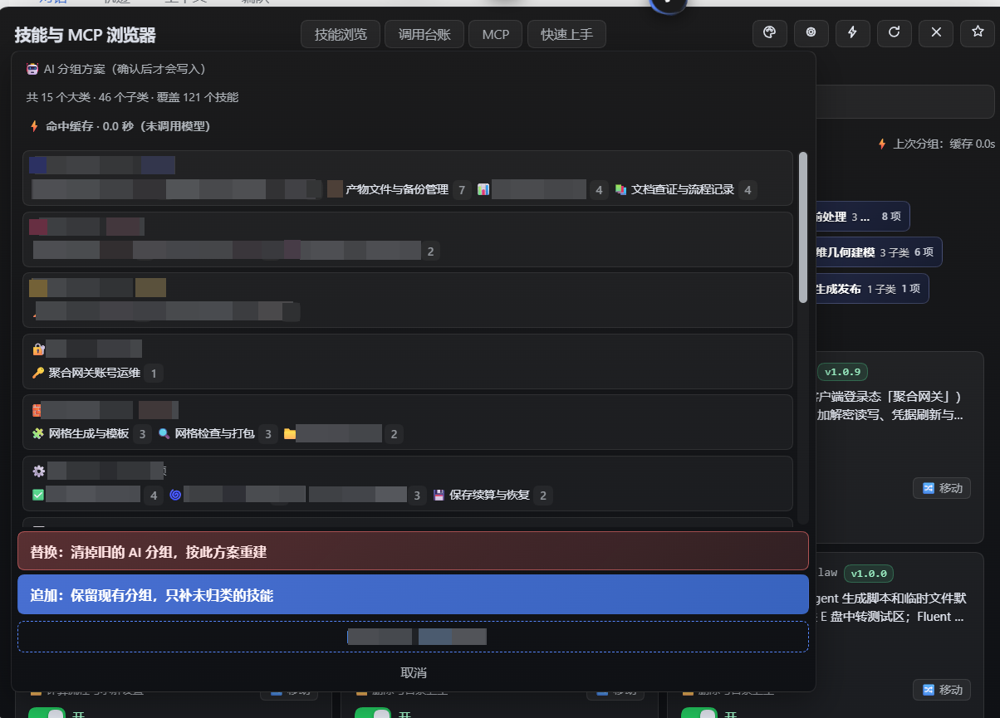
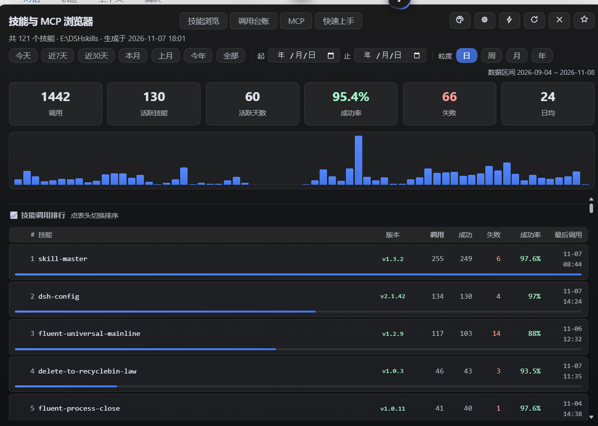
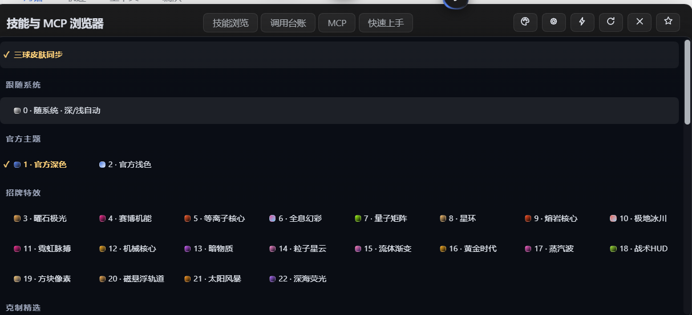
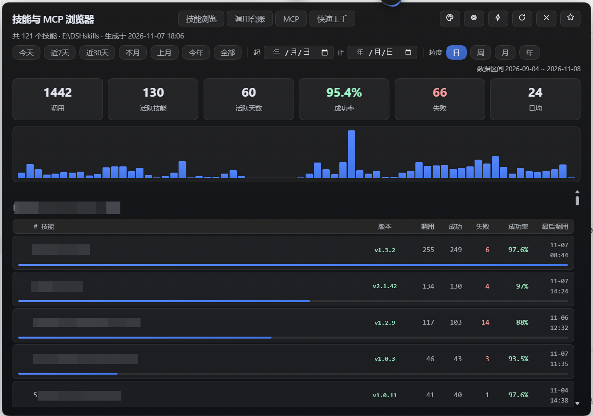
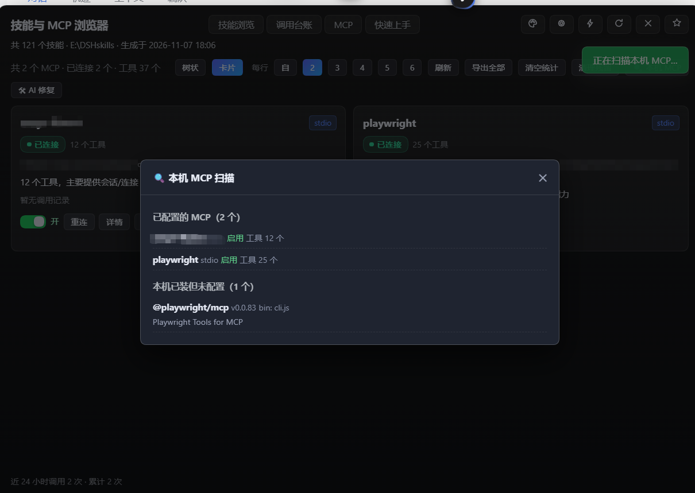
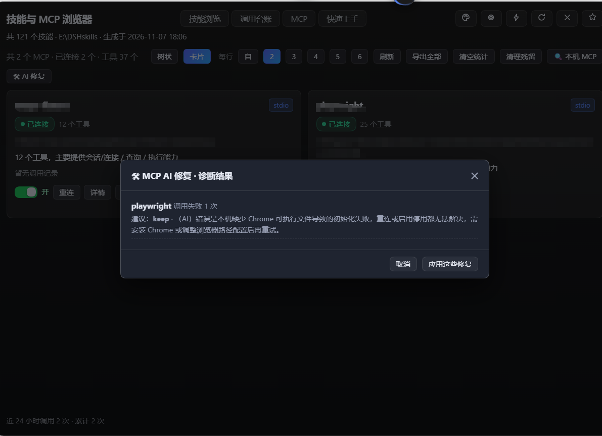
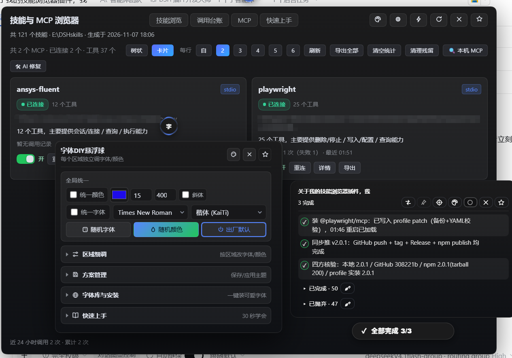
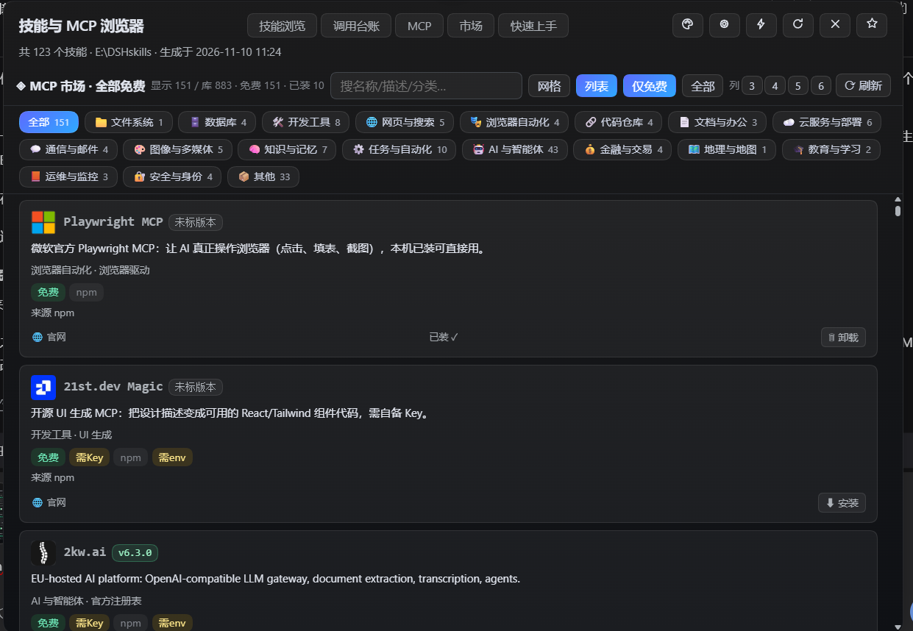
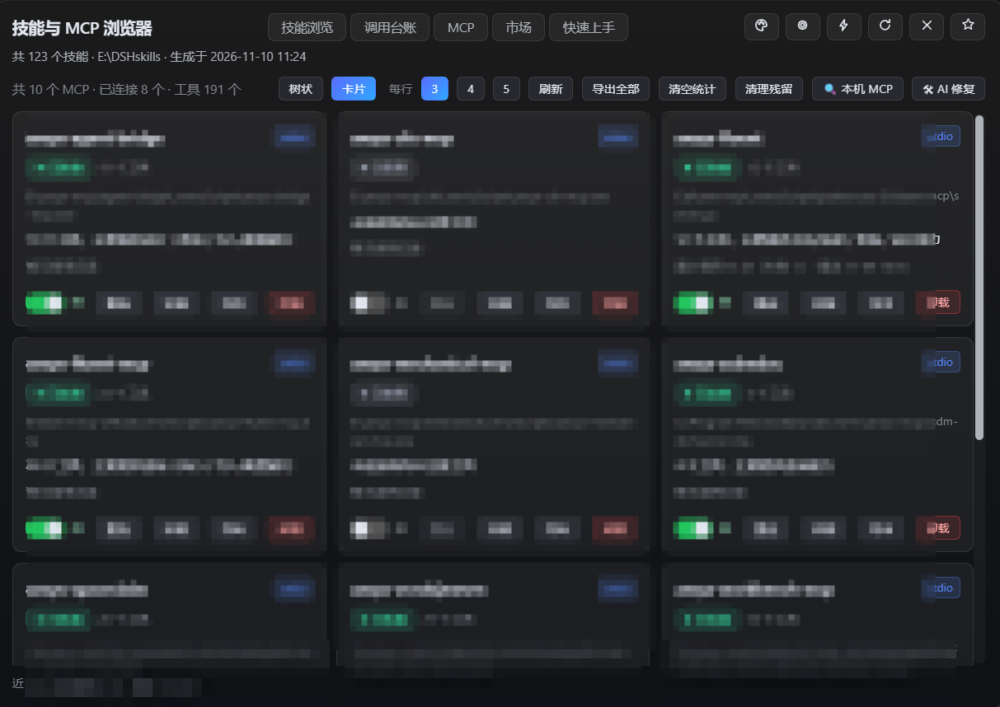

## 功能一览

### 🗂 五个 Tab

| Tab | 内容 |
|---|---|
| **技能浏览** | 搜索框 + 分组栏（树状/平铺、全部展开/收起、每行 N 列）+ 技能卡片墙（名称 / 中文简介 / 版本徽章 / 分类 / 修改时间 / 启停开关 / 移动到分组） |
| **调用台账** | 统计卡 + 趋势图 + 技能调用排行 + 自动登记流水 |
| **MCP** | MCP 服务器清单（状态 / 工具数 / 调用统计）+ 启停 / 重连 / 卸载 / 导出 + 🔍 本机 MCP 扫描 + 🛠 AI 修复 |
| **市场 · MCP 市场** | 官方 MCP Registry + 精选免费目录（29 条）双数据源；19 大类平铺分类（带每类数量）；网格/列表双模式、列数 3~6；一键安装（写 `cordis.patch.yml` 并自动备份）/ 一键卸载；仅免费筛选；24 小时磁盘缓存 |
| **快速上手** | 9 步图文引导，黑白线性图标，60 秒上手 |

> **滚动位置**：五个 Tab 各自记住上次停留的位置（`localStorage` 键 `dsb-scroll-v1`），关掉面板再打开直接回到原处；面板内重绘（启停乐观更新、轮询收敛）不会把列表甩回顶部，列表滚动容器在重绘前后被显式保存与写回。技能 Tab 里的分组栏（`#dsb-groups`）也单独记一份（`groups` 键），不会和技能卡列表互相覆盖。**市场** Tab 同样覆盖。

> **每行列数**：技能列表「每行」可选 **3 / 4 / 5 / 6**，MCP 卡片可选 **3 / 4 / 5**（3 起步，技能 6 封顶、MCP 5 封顶）。原来的「自」自适应与 2 列已移除，旧值（`auto` / `0` / `2`）会自动归一到 3 列，不会出现空白列。

### 📂 技能浏览

- **悬浮球入口**：固定在屏幕角落，点击开关面板；可拖拽换位置（位置记忆），**拖到屏幕顶部也不会丢**（`app-region: no-drag` 保护，配合 DSH 设置页「回到右下角」随时复位）
- **技能库位置自己定**：⚙ 设置里选文件夹（弹系统目录选择框），或手动粘贴路径；未配置时自动探测官方默认根 `~/.dsh/skills`，**不含任何预设路径**
- **树状 / 平铺双视图**：树状模式每个大类独占一整行，子类常驻缩进 `├─` / `└─` 挂在下方；平铺模式保留卡片墙。选择持久化记忆
- **搜索**：按技能名 / 中文简介 / 原始描述实时过滤
- **版本号徽章**：优先 SKILL.md frontmatter `version`，其次同目录 `package.json`，没有则显示「暂未编版本号」
- **技能启停**：单卡开关 / 分类级聚合滑块 / 全库批量启停（自动备份 `.bak-toggle`，停用即从模型技能目录摘除，随时可恢复）
- **详情**：点卡片看 SKILL.md 全文（触发词 / 路径 / 最近调用记录），一键复制

### 🗃 分组管理

- **手动新建分组**：「+ 新建分组」建大类 → 子类两级；技能卡片菜单里「移动」到分组
- **⚡ 关键词分组**：本地正则按触发词自动归类，零 token、毫秒级、结果确定
- **🤖 AI 自动分组**：读技能清单让模型出方案（模型可选），AI 封面自动配图
- 三种方式都**只出方案不落盘**，弹层里确认「替换 / 追加」才写入 `groups.json`
- **存在自定义分组时，默认分类行自动隐藏**，视图更干净

### 📋 调用台账

插件监听 DSH 官方 `tools/result` 事件，**自动登记每一次 skill 工具调用结果**（成功「生效 ✅」/ 失败「未生效 ❌」含错误信息），人工台账与自动登记分开显示、人工维护区永不改动。

看板提供：起止日期 + 今天 / 近 7 天 / 近 30 天 / 本月 / 上月 / 今年 / 全部七个快捷区间 + 日/周/月/年四种粒度 + 6 张统计卡（调用次数 / 活跃技能 / 活跃天数 / 成功率 / 失败 / 日均）+ 趋势图 + 排行榜（按调用、失败、成功率、最后调用、技能名排序，带版本号与迷你占比条）。实测规模参考：**1141 次调用、95.2% 成功率、122 个活跃技能**的全库统计秒级出图。

### 🔌 MCP 管理

- **读的是运行中真实配置**：枚举 `ctx.loader` 里每个 `@deepseek-ai/dsh-mcp-client` 条目，返回合并后的 serverName / transport / command / args / cwd / url / env 键名，不是读文件猜
- **真实状态**：直接读 Cordis FiberState（pending / loading / active / failed），叠加 `disabled` 与已注册工具数
- **工具清单与能力概括**：按 `mcp__<server>__` 前缀取工具与描述，按动词关键词自动归类（查询 / 执行 / 写配置 / 删除 / 导出 / 文件 / 会话）
- **调用统计（落盘）**：监听 `tools/result`，按 `mcp__<server>` 归类写入 `~/.dsh/data/dsh-skill-browser/mcp-calls.jsonl`（3MB 自动压实），卡片显示累计 / 失败与最近调用
- **启停 / 重连**：启停写入 profile `cordis.patch.yml` 末尾的受管块（幂等、**不重写整份 YAML、不丢中文注释**，改前自动备份），点下开关即刻乐观跟手、随后每 700ms 轮询到运行时状态真正翻转为止（最多约 8.4 秒，仍未翻转会明确提示「稍后点刷新或彻底重启 DSH」，不再静默弹回）；重连走 Cordis Fiber 内存重启
- **卸载**：从 profile 补丁文件里**真正删掉**该条 MCP —— 缩进感知定位 `- id: <name>` 块，连带清理上方专属注释与随之空掉的 `- insert:` 父级容器（避免留下 `insert: null` 让 loader 报错），并同步移除受管块里的同名 `disabled` 覆盖；改前自动备份到 `~/.dsh/backups/`（保留最近 20 份）。内置层 / npm 包自带的 MCP 没有补丁条目可删，会明确提示改用「停用」
- **导出**：反解为 Claude Desktop / Cursor 同构的 `mcpServers` JSON，可打码敏感环境变量
- **🔍 本机 MCP**：扫描 DSH 已配置 + 各 profile / 本地插件 / 全局 npm 里所有含 mcp 的包，列出「已配置 / 已装未配置」
- **🛠 AI 修复**：诊断异常 MCP（启动失败 / 调用失败 / 已停用），规则 + AI 给出修复动作（reconnect / enable / disable / clean），确认后执行，改配置前自动备份

### 🏠 MCP 市场

- **双数据源**：① 官方 MCP Registry（`https://registry.modelcontextprotocol.io/v0/servers`，分页 `limit=100`，去重后约 600+ 个 server）；② 本地精选免费目录 `lib/market-curated.json`（29 条，npm 24 / pypi 5，全部包名已实盘验证存在），**精选优先并去重**
- **缓存与刷新**：市场数据落盘 `~/.dsh/data/dsh-skill-browser/market.json`，24 小时有效；网络失败降级用旧缓存并标 `stale`，无缓存时只显示精选目录；需要立即取新数据时加 `?refresh=1` 强制刷新
- **19 大类 + 平铺分类**：文件系统 / 数据库 / 开发工具 / 网页与搜索 / 浏览器自动化 / 代码仓库 / 文档与办公 / 云服务与部署 / 通信与邮件 / 图像与多媒体 / 知识与记忆 / 任务与自动化 / AI 与智能体 / 金融与交易 / 地理与地图 / 教育与学习 / 运维与监控 / 安全与身份 / 其他；分类 chip 恒为**平铺胶囊**，每个 chip 带该分类条目数（与「仅免费 / 全部」范围联动重算，无条目的分类自动隐藏）
- **卡片排布仿技能卡**：网格 / 列表双模式；列数 3~6 可选（`localStorage` 键 `dsb-home-cols`）；搜索框 300ms 节流；**「仅免费 / 全部」范围筛选**（默认仅免费）；已装条目标「已装 ✓」
- **免费口径**：npm / pypi 本地可运行包 = 免费可装；只有远程 HTTP 的标「远程·需自备 Key」，不可直接安装
- **安装流程**：点「安装」→ 需要环境变量（needsKey / envRequired）时先弹层填 Key → 后端把条目写进当前 profile 的 `cordis.patch.yml` 的 `- insert:` 块（**写前自动备份到 `~/.dsh/backups/`**）→ DSH 补丁层热重载生效
- **Windows 启动方式**：npm 包用 `node.exe + npx-cli.js` 启动（stdio 走 spawn 不经 shell，直接写 `npx` 会失败）；pypi 包用 `uvx`；可执行文件路径**运行时探测**
- **卸载与回滚**：复用 MCP 页的 `uninstallMcp` —— 缩进感知删除整条条目 + 清空壳 `- insert:` + 从受管块移除同名覆盖 + 写前备份；需要回滚就从 `~/.dsh/backups/` 取最近一份 `cordis.patch.yml`
- **「已装」判定**：来自 MCP 页的 `serverName` 匹配（运行中 loader 条目名与市场条目名一致即标已装）

### 🎨 130 款皮肤（三球同步）

- 与 dsh-todo-float-ball / dsh-font-enhancer 共享同一套皮肤系统，任一处切换三个悬浮球与面板实时同步
- 内置「跟随系统（深/浅自动）」+ 官方深色 + 官方浅色等 130 款，全部面板控件按当前皮肤**实算对比度**配色，浅色主题 WCAG 达标
- 皮肤菜单 **6 列宽屏布局**，130 款一屏尽览；设置页提供「三球皮肤同步」开关
- 头部按钮全部为**黑白线性 SVG 图标**（皮肤 / 设置 / 热重载 ⚡ / 刷新 ↻ / 关闭 / GitHub Star），任何皮肤下清晰可读

### 📖 快速上手（9 步，黑白线性图标）

1. **选技能库位置**（第一步）→ 设置 → 选择文件夹 → 保存自动重扫
2. **刷新** 让新技能进列表 → 不重启 DSH 立即生效再点**热重载 ⚡**（顺序：先选库 → 再刷新 → 最后热重载）
3. **搜索与筛选**：关键词 / 分组栏树状平铺 / 关键词分组 / AI 自动分组
4. **看详情 / 启停**：卡片展开全文，可直接禁用/启用
5. **调用台账**：日期区间 + 粒度 → 排行、失败率与趋势
6. **分组管理**：新建大类/子类、移动技能；删分组不删技能文件
7. **MCP 管理**：启停 / 重连 / 卸载 / 导出、工具清单与调用统计、🔍 本机扫描、🛠 AI 修复
8. **市场**：官方 Registry + 29 条精选免费目录，19 大类平铺分类；卡片「安装」→ 需环境变量时弹层填 Key → 写入 `cordis.patch.yml`（自动备份）并热加载；已装条目显示「卸载」，双向即时同步
9. **认识面板按钮**：皮肤（130 款三球同步）→ 设置 → 热重载 → 刷新 → 关闭 → Star

### ⚙ DSH 设置页「悬浮球导航」分区（本插件提供）

- 🧩 技能球 / 🔤 字体球 / 📋 Todo 球三球**显隐开关**（未安装的自动标注）
- **悬浮球皮肤下拉**（130 款分组列出）
- **「回到右下角」金色按钮**：悬浮球被拖出屏幕外卡住时一键复位，无需重启
- **作者插件 12 款清单**：字体插件 / 技能浏览器 / Todo 进度球 / 图片灯箱 / 语音提醒 / 文献检索 / QQ 群摘要 / 模型菜单分组 / 对话归档 / 外挂识图 / 文件点击直达 / DeepSeek 网页端

## 安装

**方式一：DSH 插件市场 / npm（推荐）**

在 DSH 插件市场搜索 `dsh-skill-browser` 安装，或：

```
pnpm add dsh-skill-browser
```

并把 `"dsh-skill-browser"` 加入 profile 的 `dsh.profile.bundles` 数组，重启 DSH，右下角出现 🧩 悬浮球。

**方式二：本地目录安装（desktop profile）**

1. 把本仓库完整复制到 `~/.dsh/profiles/desktop/node_modules/dsh-skill-browser`（真实目录，不要 junction/link）
2. 在 `~/.dsh/profiles/desktop/package.json` 的 `dsh.profile.bundles` 数组加 `"dsh-skill-browser"`（**不要**加进 `dependencies`——本插件零 npm 依赖）
3. 重启 DSH，右下角出现 🧩 悬浮球；打开 ⚙ 设置选择你的技能库文件夹即可

## 适配版本

- DSH 内核（`@deepseek-ai/dsh`）：**0.2.2-rc.1**（`package.json` 的 `engines.dsh` 已声明 `>=0.1.7-rc.1`）
- DSH 桌面端：**2.0.20-next**（DSH NEXT）
- Node.js：`^22.19.0 || >=24.0.0`
- 已在上述版本实测通过；低版本 `0.1.7-rc.1` 及以上兼容。

> ⚠️ **发布 24 小时内安装报错？** 这不是插件问题。DSH 桌面端内置供应链安全策略（minimumReleaseAge）：刚发布不到 24 小时的 npm 包会被 pnpm 拒绝安装（报错含 `ERR_PNPM_MINIMUM_RELEASE_AGE_VIOLATION`）。**等一天再装即可**，无需任何配置。

## API（宿主端，仅回环可访问）

| 路由 | 说明 |
|---|---|
| `GET /dsh-skill-browser/health` | 健康检查（含 root 与识别来源） |
| `GET /dsh-skill-browser/rev` | 当前加载代号与版本（热重载探针） |
| `POST /dsh-skill-browser/reload` | 热重载 host 半代码，返回新代号 |
| `GET/POST /dsh-skill-browser/config` | 读取/保存运行时配置（skillsDir、ledgerEnabled） |
| `GET /dsh-skill-browser/skills[?refresh=1]` | 全量技能清单（含 `version`）+ 分类元数据 + 总数 |
| `GET /dsh-skill-browser/skill?dir=<name>` | 读取某技能 SKILL.md 全文 |
| `GET/POST /dsh-skill-browser/groups` | 读取/写入两级分组（`groups.json`），action：`create/rename/delete/move/assign/assign-batch/ai-classify/kw-classify/ai-apply/ai-cover/model-info` |
| `GET /dsh-skill-browser/ledger[?refresh=1]` | 人工台账表 + 自动登记统计与流水 |
| `GET /dsh-skill-browser/ledger/stats?from=&to=&gran=&sort=&top=` | 调用台账看板聚合（gran=day\|week\|month\|year，sort=calls\|fails\|rate\|last\|name） |
| `POST /dsh-skill-browser/ledger/report` | 手动上报失败 `{ skill, note, kind }` |
| `POST /dsh-skill-browser/ledger/flush` | 立即落盘队列中的登记 |
| `GET /dsh-skill-browser/ledger-detail?skill=<name>` | 该技能的人工明细 + 全部自动记录 |
| `POST /dsh-skill-browser/pick-dir` | 弹系统目录选择框（Windows） |
| `POST /dsh-skill-browser/toggle` | 单技能启停（改写 frontmatter，自动备份） |
| `POST /dsh-skill-browser/toggle-batch` | 批量启停 |
| `GET/POST /dsh-skill-browser/diag` | 诊断信息（扫描耗时、缓存状态、最近错误） |
| `GET /dsh-skill-browser/orb/<orb-*.html>` | 悬浮球静态资源 |

技能根目录解析顺序：设置页覆盖（`~/.dsh/data/dsh-skill-browser/config.json`）→ 环境变量 `DSH_SKILLS_DIR` → 插件 config `skillsDir` → `~/.dsh/skills`（官方默认根）。

## 测试

```
node test/run.js <你的技能库路径>      # 扫描/分类/frontmatter 解析
node test/ledger-test.mjs             # 台账引擎（38 项断言）
```

## License

MIT
