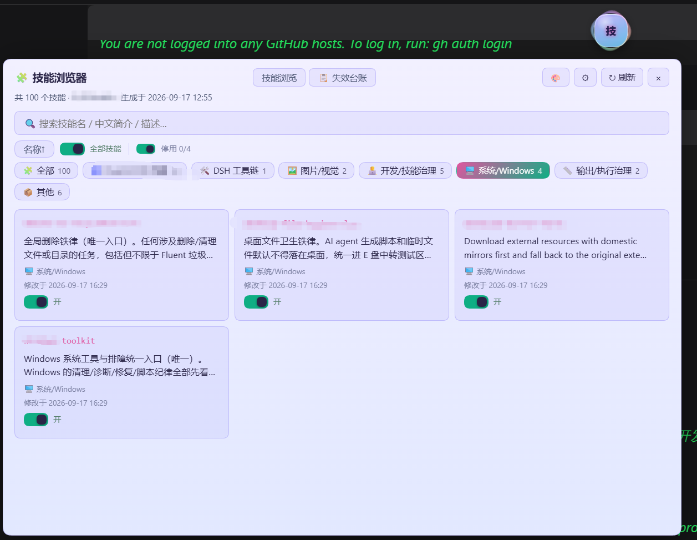

# dsh-skill-browser 🧩

**把技能库变成看得见、搜得到、管得住的资产。**

**Turn your skill library into something you can see, search, and govern.**

在 DeepSeek Harness（DSH）桌面端 / 网页端里用一个悬浮球打开面板，把本机技能库变成可浏览、可检索、可治理的资产：两级分类 + **自定义分组**（树状/平铺双模式、手动建大类与子类、⚡ 关键词分组、🤖 AI 自动分组与 AI 封面，**分组只是视图归档，绝不移动任何技能文件**）、**版本号徽章**（无版本显示「暂未编版本号」）、单卡 / 分类 / 全库启停（自动备份 `.bak-toggle`）、SKILL.md 全文查看；内置 **调用台账看板**（起止日期 + 日/周/月/年 + 排行榜 + 趋势图 + 失效明细），监听 DSH 官方 `tools/result` 事件自动登记每次技能调用结果。面板 ⚡ 一键热重载，**128 款皮肤全量自适应配色**（对比度实算），技能库位置可配置，悬浮球可拖拽可复位。

Open a floating-ball panel inside DeepSeek Harness (DSH) and turn your local skill library into something you can browse, search and govern: one/two-level categories plus **custom groups** (tree/flat views, manual parent/child groups, ⚡ instant keyword grouping, 🤖 AI auto-grouping with AI-generated covers — **grouping is view-only and never moves a skill file**), **version badges** (falling back to "no version yet"), per-card / per-category / library-wide enable-disable with automatic `.bak-toggle` backups, and a full SKILL.md viewer. A **call-ledger dashboard** adds date ranges, day/week/month/year granularity, rankings, a trend chart and failure details, fed automatically by DSH's native `tools/result` event. One-click ⚡ hot reload, **all 128 ball skins contrast-adaptive**, configurable skill root, draggable and resettable ball.




> 技能浏览页：顶部技能总数与生成时间，搜索框 + 「全部技能」聚合启停滑块（可一键全启用 / 全停用，或点开批量选择），分类标签一行排开，主体是技能卡片墙（技能名 / 中文简介 / 分类 / 修改时间 / 开关）。
> Browse view: skill count, search box, category chips, and a wall of skill cards.

### 独门功能：技能失效台账 · Signature feature: the failure ledger

技能调用了，可到底生效没有？插件监听 DSH 官方 `tools/result` 事件，**自动登记每一次 skill 工具调用结果**——成功记「生效 ✅」，加载失败记「未生效 ❌」并带上错误信息。人工台账与自动登记分开显示，人工维护区**插件永不改动**。

Did that skill actually work? The plugin listens to DSH's native `tools/result` event and **automatically logs every `skill` tool call** — successes "effective ✅", load failures "ineffective ❌" with the error. The manual ledger and the automatic log display separately, and the plugin never touches your manually maintained section.

---

## 功能

- **悬浮球 🧩**：固定在屏幕角落，点击开关面板；可拖拽换位置（位置记忆），Alt+点击收起成小圆点
- **技能库位置自己定**：首次使用在面板 ⚙ 设置里选择技能库文件夹（弹系统目录选择框），或手动粘贴路径；未配置时自动探测官方默认根 `~/.dsh/skills`。**插件不含任何预设路径**
- **一级/二级分类**：按技能目录名模式自动归类（Fluent/CFD 仿真、DSH 工具链、多端协同、Excel/表格、文档处理、图片/视觉、语音/媒体、数据/可视化、开发/技能治理等 15 个一级分类与 Fluent/DSH 域二级分类）
- **自定义分组（v1.9.0 起，v1.9.8 支持树状/平铺双模式）**：分组栏可手动新建「大类 → 子类」两级分组，也可用「⚡ 关键词分组」（本地正则，零 token、毫秒级、结果确定）或「🤖 AI 自动分组」（读技能清单让模型出方案）自动建组。AI / 关键词都**只出方案不落盘**，方案弹层里确认「替换」或「追加」才写入 `groups.json`。**分组只是视图归档，绝不移动、不重命名任何技能文件。**
- **树状 / 平铺双模式**：树状模式下每个大类独占一整行，子类常驻缩进挂在下方并用 `├─` / `└─` 树杈连接，一眼看清「Fluent 下面有画网格 / 后处理 / SpaceClaim 几何操作」；平铺模式保留旧版卡片墙。选择持久化到 `localStorage.dsh-skill-browser-gmode`。
- **版本号徽章（v1.9.0 起）**：技能名右侧显示版本号（优先 SKILL.md frontmatter 的 `version`，其次同目录 `package.json` 的 `version`），没有版本号则显示「暂未编版本号」。
- **技能启停**（v1.7.0 起）：单个技能卡片开关 / 分类级聚合滑块 / 全库批量启停（带确认菜单）。停用即改写该技能 `SKILL.md` frontmatter 的 `disable-model-invocation`，改写前自动备份为 `.bak-toggle`，停用卡灰显并带徽章；随时可一键恢复
- **中文简介**：技能简介直接取自各技能 SKILL.md frontmatter 的 description（v1.5.0 起插件不内置任何技能名清单/字典，避免泄漏技能库构成，也保证所有人看到的是自己技能库的准确描述）
- **搜索**：按技能名 / 中文简介 / 原始描述实时过滤
- **详情**：点击卡片查看 SKILL.md 全文，可一键复制
- **调用台账看板（v1.9.1 起）**：台账页从「原始流水」升级为看板——起止日期筛选 + 今天/近 7 天/近 30 天/本月/上月/今年/全部七个快捷区间 + 日/周/月/年四种粒度 + 6 张指标卡（调用次数 / 活跃技能 / 活跃天数 / 成功率 / 失败 / 日均）+ 纯 CSS 趋势柱 + 排行榜（可按调用、失败、成功率、最后调用、技能名排序，带版本号与迷你占比条）。原始流水（人工台账 + 自动登记）折叠在下方。
- **热重载（v1.9.4 起）**：面板头部 ⚡ 按钮调用 `POST /reload`，插件重新加载自己的 host 半代码（`?v=<ts>` 绕开 ESM 缓存）并递增代号，前端轮询 `GET /rev` 等到代号变化后自动刷新界面——**改完代码不用重启桌面端**。
- **性能（v1.9.6 起）**：技能卡片分片渲染（一次 60 张，滚到底自动追加），原始流水分片渲染（一次 120 行），jsonl 走尾部增量读取，`/ledger/stats` 缓存键并入 jsonl 的 size+mtime，详情页默认只回最近 200 条。
- **全皮肤自适应配色（v1.9.2 / v1.9.5 / v1.9.9 三轮加固）**：面板所有新增控件（分组栏、版本徽章、台账看板、吸顶表头）颜色全部走语义变量（`--dsb-brand` / `--dsb-dim` / `--dsb-ok` / `--dsb-fail` / `--dsb-warn` / `--dsb-surface` / `--dsb-onbrand` 等），按当前皮肤实际叠层背景实算对比度，128 款皮肤 × 18 组前景/背景组合共 2304 项全部达标。
- **失效台账**（人工 / 自动分开显示）：
  - **👤 人工台账**：解析台账 md 的统计表与失败明细（人工维护区，插件永不改动）
  - **🤖 自动登记**：插件监听 DSH 官方 `tools/result` 事件，自动记录每次 `skill` 工具调用结果——成功记「生效✅」、加载失败记「未生效❌」（含错误信息）
  - **登记口令**：技能触发失败时，在对话里对 AI 说「触发失败，登记」或「登记失败：技能名 原因」，AI 调用上报接口写入台账
- **台账智能发现**：初始化时全库搜索台账文件（文件名含「失效台账 / 失败台账 / 生效-失效」等关键词，约定路径 `skill-master/references/` 优先）；搜到就复用，没搜到才创建默认台账 + `skill-master` 技能骨架（幂等，已有人工内容绝不覆盖）
- **推荐插件**：面板 ⚙ 设置展开区（技能库位置下方）保留 3 张推荐卡（照片显示器 dsh-chat-image-lightbox、字体插件 dsh-font-enhancer、Todo 悬浮球 dsh-todo-float-ball）；DSH 设置页有 4 条推荐记录；v1.5.3 起技能列表每页末尾不再显示推荐（用户反馈心烦）
- **DSH 设置页分区「悬浮球导航」**：在 DSH 设置中即可控制 🧩 技能球 / 🔤 字体球（若安装了字体插件）/ 📋 Todo 悬浮球（若安装了 todo 插件）的显示与隐藏；v1.5.3 新增「🎯 一键恢复悬浮球默认位置（右下角）」按钮——悬浮球被拖出屏幕外卡住时点一下立即复位（清位置记忆/收起状态，无需重启）

## 🎨 三球共享 128 皮肤
与 dsh-todo-float-ball / dsh-font-enhancer 共享同一套 128 款皮肤目录（window.__DSH_BALL_SKINS，localStorage key dsh-ball-skin）。任一处切换，三个悬浮球与其展开面板实时同步；「原版（仅本球）」可让技能球单独回到原始星云紫。v1.8.x：全部面板控件（含技能详情正文、tab、开关、批量菜单）跟随皮肤，浅色主题文字对比度 WCAG 达标。

## Highlights (English)

- 🧩 **Floating-ball entry** — pinned to a screen corner, click to toggle the panel; draggable with position memory, Alt+click to collapse to a dot.
- 📂 **Configurable skill root** — pick the folder via the native directory chooser in ⚙ settings, or paste a path; auto-detects the official `~/.dsh/skills` root when unset. **No hard-coded paths shipped.**
- 📚 **Two-level categories** — auto-classified from skill directory names (15 top-level categories: Fluent/CFD simulation, DSH toolchain, multi-client collaboration, Excel/spreadsheets, document processing, image/vision, voice/media, data/visualisation, dev/skill governance…).
- 🗂 **Custom groups** (since v1.9.0; tree/flat dual view since v1.9.8) — create your own two-level `domain → sub` groups by hand, or let **⚡ keyword grouping** (local regex, zero tokens, millisecond, deterministic) / **🤖 AI auto-grouping** build them for you. Both only produce a *plan*; nothing is written to `groups.json` until you confirm **Replace** or **Merge**. **Groups are a view-only archive — no skill file is ever moved or renamed.**
- 🌳 **Tree / flat views** — tree mode gives every domain its own full-width row with its sub-groups permanently indented underneath, joined by `├─` / `└─` branches, so "Fluent → meshing / post-processing / SpaceClaim geometry" is visible at a glance. Choice persisted in `localStorage.dsh-skill-browser-gmode`.
- 🏷 **Version badges** (since v1.9.0) — the skill's version sits right next to its name (frontmatter `version`, else the sibling `package.json` `version`), showing "not versioned yet" when absent.
- 🔘 **Skill enable/disable** (since v1.7.0) — per-card switch, category-level aggregate slider, and whole-library batch toggle with a confirmation menu. Disabling rewrites the skill's `SKILL.md` frontmatter `disable-model-invocation` after backing it up to `.bak-toggle`; disabled cards grey out with a badge and can be restored at any time.
- 🇨🇳 **Chinese summaries** — taken straight from each skill's `SKILL.md` frontmatter `description`. Since v1.5.0 the plugin ships **no built-in skill dictionary**, so you always see an accurate description of *your own* library.
- 🔍 **Live search** — filter by skill name, Chinese summary, or raw description.
- 📄 **Full-text viewer** — click a card for the complete `SKILL.md`, with one-click copy.
- 🤖 **Automatic failure ledger** — driven by the native `tools/result` event; manual and automatic records shown separately, manual content never modified.
- 📋 **Ledger auto-discovery** — scans the whole library for an existing ledger (filename keywords, with `skill-master/references/` preferred) and reuses it; creates a default one only if absent. Idempotent, never overwrites manual content.
- ⚙️ **Settings integration** — toggle the skill 🧩 / font 🔤 balls from DSH settings, plus a **🎯 reset-to-default-position** button that un-sticks a ball dragged off-screen (no restart needed).
- 🎨 **128 shared ball skins** — synced live with `dsh-todo-float-ball` and `dsh-font-enhancer`; all panel controls are themed with WCAG-compliant contrast in light themes.

## 安装（desktop profile）

1. 把本目录完整复制到 `~/.dsh/profiles/desktop/node_modules/dsh-skill-browser`（真实目录，不要 junction/link）
2. 在 `~/.dsh/profiles/desktop/package.json` 的 `dsh.profile.bundles` 数组加 `"dsh-skill-browser"`
   （**不要**加进 `dependencies`——本插件零 npm 依赖，加进去反而可能在其他插件安装/更新时造成解析问题）
3. 重启 DSH，右下角出现 🧩 悬浮球；打开 ⚙ 设置选择你的技能库文件夹即可


## ⚠️ 安装须知 Install Notice

**发布 24 小时内安装报错？** 这不是插件问题。

DSH 桌面端内置**供应链安全策略**（minimumReleaseAge）：刚发布不到 24 小时的 npm 包会被 pnpm 拒绝安装，防止刚发布的投毒包。报错通常含 `ERR_PNPM_MINIMUM_RELEASE_AGE_VIOLATION` 字样。

- ✅ **解决：等一天再装**，市场安装自然通过
- ✅ 插件本体没有任何问题，也无需任何配置
- ✅ 此策略对所有 DSH 插件一视同仁，是全局安全机制

**推荐清单说明**：两个插件的设置页「悬浮球导航」分区会列出推荐插件（字体插件 / 技能浏览器 / 照片显示器），并实时探测显示「已安装 / 未安装」徽标；未安装的插件可点击 Star 前往仓库安装。

## 台账自动登记原理

- 数据源 1（自动，确定性）：`ctx.on('tools/result', (exec, result) => ...)`，过滤 `exec.name === 'skill'`；`result.isError` 为真记失败，同时记录 `exec.arguments.name`（技能名）与错误文本
- 数据源 2（手动，语义层）：`POST /ledger/report { skill, note, kind }`，对话 AI 发现用户纠错/技能未达预期时调用
- 台账文件：初始化时搜索技能库（文件名含「失效台账 / 失败台账 / 生效-失效」等，约定路径优先）；搜到则复用并在插件标记区块内增量写入（**人工内容永不改动**，首次接管自动备份）；没搜到则在 `skill-master/references/技能生效-失效台账.md` 创建默认台账
- 全量机器可读流水：`<技能库>/skill-master/references/技能失效-自动登记.jsonl`
- 写盘节流：队列满 5 条或 60 秒批量落盘，绝不阻塞工具调用

## API（宿主端，仅回环可访问）

| 路由 | 说明 |
|---|---|
| `GET /dsh-skill-browser/health` | 健康检查（含 root 与识别来源） |
| `GET /dsh-skill-browser/rev` | 当前加载代号与版本（热重载探针） |
| `POST /dsh-skill-browser/reload` | 热重载 host 半代码，返回新代号（v1.9.4） |
| `GET/POST /dsh-skill-browser/config` | 读取/保存运行时配置（skillsDir、ledgerEnabled） |
| `GET /dsh-skill-browser/skills[?refresh=1]` | 全量技能清单（含 `version` 字段）+ 分类元数据 + 总数 |
| `GET /dsh-skill-browser/skill?dir=<name>` | 读取某技能 SKILL.md 全文 |
| `GET/POST /dsh-skill-browser/groups` | 读取/写入两级分组（`groups.json`）。POST 的 `action`：`create` / `rename` / `delete` / `move` / `assign` / `assign-batch` / `ai-classify` / `kw-classify` / `ai-apply` / `ai-cover` / `model-info` |
| `GET /dsh-skill-browser/ledger[?refresh=1]` | 人工台账表 + 自动登记统计与流水 |
| `GET /dsh-skill-browser/ledger/stats?from=&to=&gran=&sort=&top=` | 调用台账看板聚合（`gran`=day\|week\|month\|year，`sort`=calls\|fails\|rate\|last\|name） |
| `POST /dsh-skill-browser/ledger/report` | 手动上报失败 `{ skill, note, kind }` |
| `POST /dsh-skill-browser/ledger/flush` | 立即落盘队列中的登记 |
| `GET /dsh-skill-browser/ledger-detail?skill=<name>` | 该技能的人工明细 + 全部自动记录 |
| `POST /dsh-skill-browser/pick-dir` | 弹系统目录选择框（Windows） |
| `POST /dsh-skill-browser/toggle` | 单技能启停 `{ dir, enabled }`（改写 SKILL.md frontmatter，自动备份 `.bak-toggle`） |
| `POST /dsh-skill-browser/toggle-batch` | 批量启停 `{ dirs: [...], enabled }`（分类级聚合滑块与全库批量走这里） |
| `GET/POST /dsh-skill-browser/diag` | 诊断信息（扫描耗时、缓存状态、最近错误） |
| `GET /dsh-skill-browser/orb/<orb-*.html>` | 悬浮球静态资源（皮肤精灵图等） |

技能根目录解析顺序：设置页覆盖（`~/.dsh/data/dsh-skill-browser/config.json`）→ 环境变量 `DSH_SKILLS_DIR` → 插件 config `skillsDir` → `~/.dsh/skills`（官方默认根）。全部未命中时面板提示选择目录。

## 测试

```
node test/run.js <你的技能库路径>      # 扫描/分类/frontmatter 解析
node test/ledger-test.mjs             # 台账引擎（38 项断言）
```

## License

MIT
