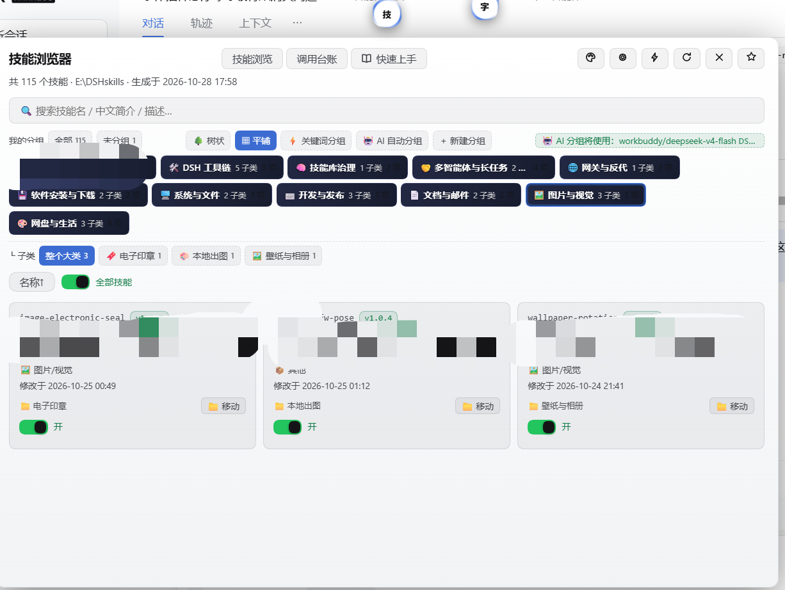
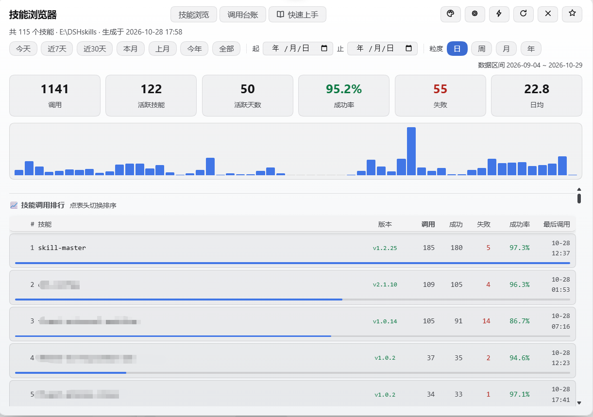

# dsh-skill-browser 🧩 技能浏览器

**把技能库变成看得见、搜得到、管得住的资产。**

DeepSeek Harness（DSH）桌面端 / 网页端插件：右下角一个「技」字悬浮球，点开即技能浏览器面板——115+ 技能秒级浏览、树状/平铺双视图、手动 + 关键词 + AI 三种分组、调用台账看板、130 款三球同步皮肤。**分组只是视图归档，绝不移动任何技能文件。**



## 功能一览

### 🗂 三个 Tab

| Tab | 内容 |
|---|---|
| **技能浏览** | 搜索框 + 分组栏 + 技能卡片墙（名称 / 中文简介 / 版本徽章 / 分类 / 修改时间 / 启停开关 / 移动到分组） |
| **调用台账** | 统计卡 + 趋势图 + 技能调用排行 + 原始流水 |
| **快速上手** | 7 步图文引导，黑白线性图标，60 秒上手 |

### 📂 技能浏览

- **悬浮球入口**：固定在屏幕角落，点击开关面板；可拖拽换位置（位置记忆），**拖到屏幕顶部也不会丢**（`app-region: no-drag` 保护，配合 DSH 设置页「回到右下角」随时复位）
- **技能库位置自己定**：⚙ 设置里选文件夹（弹系统目录选择框），或手动粘贴路径；未配置时自动探测官方默认根 `~/.dsh/skills`，**不含任何预设路径**
- **树状 / 平铺双视图**：树状模式每个大类独占一整行，子类常驻缩进 `├─` / `└─` 挂在下方；平铺模式保留卡片墙。选择持久化记忆
- **搜索**：按技能名 / 中文简介 / 原始描述实时过滤
- **版本号徽章**：优先 SKILL.md frontmatter `version`，其次同目录 `package.json`，没有则显示「暂未编版本号」
- **技能启停**：单卡开关 / 分类级聚合滑块 / 全库批量启停（自动备份 `.bak-toggle`，停用即从模型技能目录摘除，随时可恢复）
- **详情**：点卡片看 SKILL.md 全文（触发词 / 路径 / 最近调用记录），一键复制

### 🗃 分组管理

- **手动新建分组**：「+ 新建分组」建大类 → 子类两级；技能卡片菜单里「移动」到分组
- **⚡ 关键词分组**：本地正则按触发词自动归类，零 token、毫秒级、结果确定
- **🤖 AI 自动分组**：读技能清单让模型出方案（模型可选），AI 封面自动配图
- 三种方式都**只出方案不落盘**，弹层里确认「替换 / 追加」才写入 `groups.json`
- **存在自定义分组时，默认分类行自动隐藏**，视图更干净

### 📋 调用台账

插件监听 DSH 官方 `tools/result` 事件，**自动登记每一次 skill 工具调用结果**（成功「生效 ✅」/ 失败「未生效 ❌」含错误信息），人工台账与自动登记分开显示、人工维护区永不改动。

看板提供：起止日期 + 今天 / 近 7 天 / 近 30 天 / 本月 / 上月 / 今年 / 全部七个快捷区间 + 日/周/月/年四种粒度 + 6 张统计卡（调用次数 / 活跃技能 / 活跃天数 / 成功率 / 失败 / 日均）+ 趋势图 + 排行榜（按调用、失败、成功率、最后调用、技能名排序，带版本号与迷你占比条）。实测规模参考：**1141 次调用、95.2% 成功率、122 个活跃技能**的全库统计秒级出图。



### 🎨 130 款皮肤（三球同步）

- 与 dsh-todo-float-ball / dsh-font-enhancer 共享同一套皮肤系统，任一处切换三个悬浮球与面板实时同步
- 内置「跟随系统（深/浅自动）」+ 官方深色 + 官方浅色等 130 款，全部面板控件按当前皮肤**实算对比度**配色，浅色主题 WCAG 达标
- 皮肤菜单 **6 列宽屏布局**，130 款一屏尽览；设置页提供「三球皮肤同步」开关
- 头部按钮全部为**黑白线性 SVG 图标**（皮肤 / 设置 / 热重载 ⚡ / 刷新 ↻ / 关闭 / GitHub Star），任何皮肤下清晰可读

### 📖 快速上手（7 步，黑白线性图标）

1. **选技能库位置**（第一步）→ 设置 → 选择文件夹 → 保存自动重扫
2. **刷新** 让新技能进列表 → 不重启 DSH 立即生效再点**热重载 ⚡**（顺序：先选库 → 再刷新 → 最后热重载）
3. **搜索与筛选**：关键词 / 树状平铺 / 关键词分组 / AI 自动分组
4. **看详情 / 启停**：卡片展开全文，可直接禁用/启用
5. **调用台账**：日期区间 + 粒度 → 排行、失败率与趋势
6. **分组管理**：新建大类/子类、移动技能；删分组不删技能文件
7. **认识面板按钮**：皮肤（130 款三球同步）→ 设置 → 热重载 → 刷新 → 关闭 → Star

### ⚙ DSH 设置页「悬浮球导航」分区（本插件提供）

- 🧩 技能球 / 🔤 字体球 / 📋 Todo 球三球**显隐开关**（未安装的自动标注）
- **悬浮球皮肤下拉**（130 款分组列出）
- **「回到右下角」金色按钮**：悬浮球被拖出屏幕外卡住时一键复位，无需重启
- **作者插件 12 款清单**：字体插件 / 技能浏览器 / Todo 进度球 / 图片灯箱 / 语音提醒 / 文献检索 / QQ 群摘要 / 模型菜单分组 / 对话归档 / 外挂识图 / 文件点击直达 / DeepSeek 网页端

## 安装

**方式一：DSH 插件市场 / npm（推荐）**

在 DSH 插件市场搜索 `dsh-skill-browser` 安装，或：

```
pnpm add dsh-skill-browser
```

并把 `"dsh-skill-browser"` 加入 profile 的 `dsh.profile.bundles` 数组，重启 DSH，右下角出现 🧩 悬浮球。

**方式二：本地目录安装（desktop profile）**

1. 把本仓库完整复制到 `~/.dsh/profiles/desktop/node_modules/dsh-skill-browser`（真实目录，不要 junction/link）
2. 在 `~/.dsh/profiles/desktop/package.json` 的 `dsh.profile.bundles` 数组加 `"dsh-skill-browser"`（**不要**加进 `dependencies`——本插件零 npm 依赖）
3. 重启 DSH，右下角出现 🧩 悬浮球；打开 ⚙ 设置选择你的技能库文件夹即可

> ⚠️ **发布 24 小时内安装报错？** 这不是插件问题。DSH 桌面端内置供应链安全策略（minimumReleaseAge）：刚发布不到 24 小时的 npm 包会被 pnpm 拒绝安装（报错含 `ERR_PNPM_MINIMUM_RELEASE_AGE_VIOLATION`）。**等一天再装即可**，无需任何配置。

## API（宿主端，仅回环可访问）

| 路由 | 说明 |
|---|---|
| `GET /dsh-skill-browser/health` | 健康检查（含 root 与识别来源） |
| `GET /dsh-skill-browser/rev` | 当前加载代号与版本（热重载探针） |
| `POST /dsh-skill-browser/reload` | 热重载 host 半代码，返回新代号 |
| `GET/POST /dsh-skill-browser/config` | 读取/保存运行时配置（skillsDir、ledgerEnabled） |
| `GET /dsh-skill-browser/skills[?refresh=1]` | 全量技能清单（含 `version`）+ 分类元数据 + 总数 |
| `GET /dsh-skill-browser/skill?dir=<name>` | 读取某技能 SKILL.md 全文 |
| `GET/POST /dsh-skill-browser/groups` | 读取/写入两级分组（`groups.json`），action：`create/rename/delete/move/assign/assign-batch/ai-classify/kw-classify/ai-apply/ai-cover/model-info` |
| `GET /dsh-skill-browser/ledger[?refresh=1]` | 人工台账表 + 自动登记统计与流水 |
| `GET /dsh-skill-browser/ledger/stats?from=&to=&gran=&sort=&top=` | 调用台账看板聚合（gran=day\|week\|month\|year，sort=calls\|fails\|rate\|last\|name） |
| `POST /dsh-skill-browser/ledger/report` | 手动上报失败 `{ skill, note, kind }` |
| `POST /dsh-skill-browser/ledger/flush` | 立即落盘队列中的登记 |
| `GET /dsh-skill-browser/ledger-detail?skill=<name>` | 该技能的人工明细 + 全部自动记录 |
| `POST /dsh-skill-browser/pick-dir` | 弹系统目录选择框（Windows） |
| `POST /dsh-skill-browser/toggle` | 单技能启停（改写 frontmatter，自动备份） |
| `POST /dsh-skill-browser/toggle-batch` | 批量启停 |
| `GET/POST /dsh-skill-browser/diag` | 诊断信息（扫描耗时、缓存状态、最近错误） |
| `GET /dsh-skill-browser/orb/<orb-*.html>` | 悬浮球静态资源 |

技能根目录解析顺序：设置页覆盖（`~/.dsh/data/dsh-skill-browser/config.json`）→ 环境变量 `DSH_SKILLS_DIR` → 插件 config `skillsDir` → `~/.dsh/skills`（官方默认根）。

## 测试

```
node test/run.js <你的技能库路径>      # 扫描/分类/frontmatter 解析
node test/ledger-test.mjs             # 台账引擎（38 项断言）
```

## License

MIT
